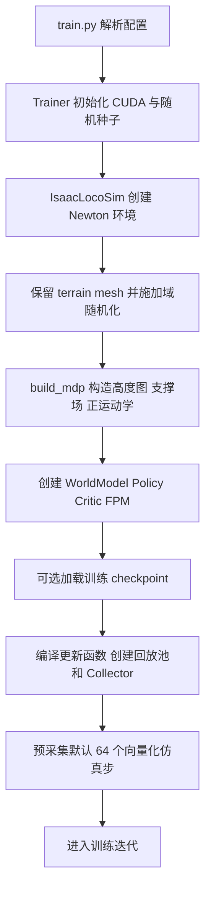
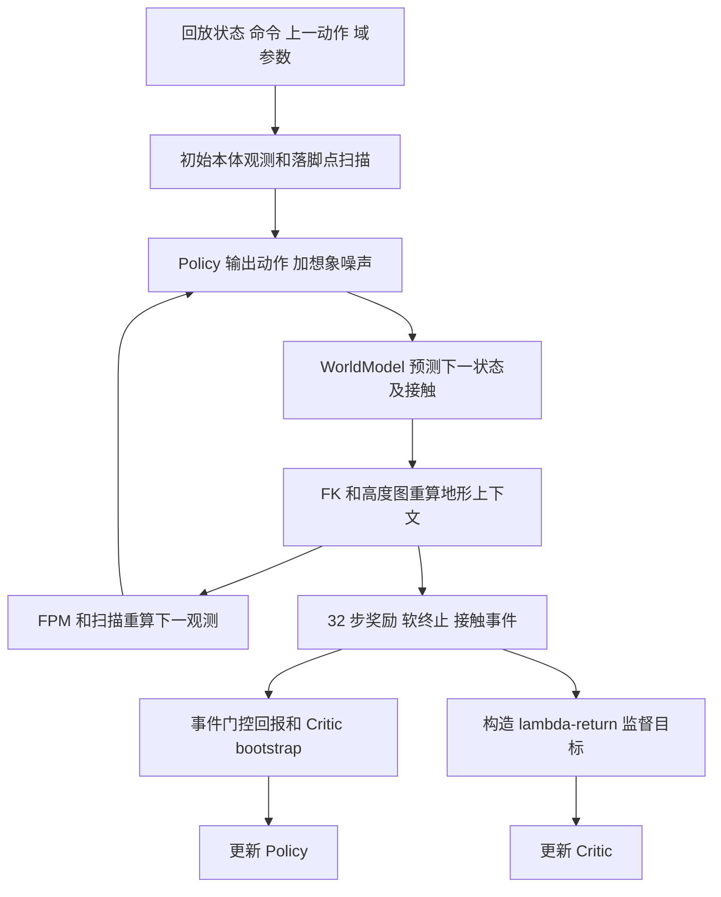

# Terrain-Grounded Imagination：整体流程、训练机制与代码阅读指南

本文根据 **2026-11-24 本地工作区源码**整理，仓库位置为 `/home/ljp/human_learn/terrain-grounded-imagination-main`。写法参考你提供的 H1 SuperMimic Deploy《整体代码解析》：先建立整体数据流，再解释关键张量、训练与推理过程，最后讨论参数、评估和容易踩坑的地方。

这里的机器人是 **29 自由度 Unitree G1**。本文核对了 Python、Shell、配置和模型文件组织，没有执行训练、物理仿真、策略推理或真机控制。涉及性能的 README 描述不作为本机实测结果；“我的理解”表示依据代码作出的解释。

代码链接相对于本文所在的 `docs/` 目录；链接文字中的 `:行号` 和函数名用于定位当前版本。部分 Markdown 阅读器不支持本地 `#L行号` 跳转，此时打开文件后搜索函数名即可。文中的伪代码是为了说明执行顺序，不是可直接替换原实现的代码。

## 阅读导航

| 想弄清的问题 | 对应章节 |
|---|---|
| TGI 在解决什么问题，与动作模仿项目有什么不同 | 1 |
| `fpm` 和 `tgi` 是什么关系，应该运行哪个入口 | 2 |
| 71、70、99、102、201、205、198 这些维度是什么意思 | 3 |
| 训练开始前初始化了什么 | 4 |
| 仿真数据怎样进入回放池，如何处理重置和推扰 | 5 |
| “地形约束想象”到底体现在哪里 | 6 |
| 世界模型怎样训练、预测哪些量 | 7 |
| FPM 怎样预测落脚点，策略怎样看到地形 | 8 |
| 想象训练、梯度截断、Critic 是怎样配合的 | 9 |
| 奖励为什么能引导机器人跨越稀疏地形 | 10 |
| 地形课程、域随机化和训练阶段 | 11、12 |
| 权重怎样导出，运行时怎样变成关节运动 | 13、14 |
| 评估结果、日志和参数应该怎么看 | 15、16 |
| 运行命令、实现限制和源码阅读顺序 | 17、18 |

## 1. 仓库整体解决的问题

### 1.1 输入的是速度指令与地形，目标是学会行走

TGI 的主要任务是：给 G1 一个速度指令，例如“向前走 0.6 m/s”，让它根据当前身体状态和地形，在台阶、石块、间隙等环境中保持平衡并完成运动。

它没有把人体参考动作 NPZ 作为主训练输入，也没有逐帧跟踪一个指定的动作片段。核心输入是：

- 机器人状态，包括姿态、速度和关节状态。
- 运动指令 `cmd = [vx, vy, wz]`。
- 地形信息，包括高度图和预测落脚点附近的局部扫描。

**代码位置：**[命令配置](../fpm/src/fpm/tasks/locomotion/config/g1/env_cfg.py#L45)，`CommandsCfg`；[策略观测](../tgi/src/tgi/mdp/interface.py#L93)，`policy_proprio()`。

与 H1 SuperMimic 部署文档对照理解：

| 对比对象 | H1 SuperMimic 部署文档中的主链路 | 本仓库 TGI 主链路 |
|---|---|---|
| 行为目标 | 跟踪参考动作 | 跟踪速度命令并适应地形 |
| 在线条件 | 当前状态、历史和未来参考目标 | 当前状态、速度命令、落脚点局部地形 |
| 本仓库重点 | 已训练策略的执行 | 世界模型、策略和 FPM 的训练，以及导出验证 |
| 世界模型 | 部署链路不必运行世界模型 | 世界模型直接参与策略训练 |
| 运行时是否做想象 | 以其具体部署实现为准 | 本仓库导出的控制器不运行世界模型想象 |

### 1.2 整体由两个闭环组成

第一个闭环发生在物理仿真器中，负责提供数据：

```text
机器人实际仿真状态 + 速度命令
          ↓
FPM 预测下一次落脚位置 → 读取落脚点附近地形
          ↓
策略输出 29 维动作 → 关节目标 → 物理仿真
          ↑                            ↓
          └────────── 新状态 ──────────┘
```

第二个闭环发生在可微计算图中，负责更新策略：

```text
从回放池取起始状态
      ↓
策略 → 世界模型预测下一状态 → 重新查询地形、构建观测
 ↑                                      ↓
 └──────── 重复默认 32 步 ──────────────┘
      ↓
计算奖励、软终止和 Critic 价值
      ↓
把回报梯度通过世界模型传回策略
```

因此，“通过世界模型训练策略”仍然需要持续采集物理仿真数据。物理仿真器提供动力学监督，世界模型提供可微的预测链路。

**代码位置：**[trainer.py:380](../tgi/src/tgi/training/trainer.py#L380)，`Trainer.run()`；[collector.py:38](../tgi/src/tgi/training/collector.py#L38)，`Collector._simulate()`；[trainer.py:253](../tgi/src/tgi/training/trainer.py#L253)，`policy_update()`。

### 1.3 我的理解：把难学习的动力学和已知的地形分开

这里的设计重点是分工。网络学习“机器人在当前支撑条件下，执行这个动作后会怎样变化”；地形位置、高度和间隙则由显式高度图提供。

机器人在想象中向前移动以后，代码会在新的位置重新查询地形。所以模型不需要把整片场景记忆在权重中，也不能仅靠自己预测一个模糊的“前方大概是平地”。但这并不意味着想象的动力学一定正确：接触状态和运动仍由学习模型预测，后面的事件截断就是在处理这部分不可靠性。

**代码位置：**[networks.py:94](../tgi/src/tgi/world_model/networks.py#L94)，`WorldModel.step()`；[mdp.py:112](../tgi/src/tgi/mdp/mdp.py#L112)，`MDP.context()`；[terrain.py:54](../tgi/src/tgi/mdp/terrain.py#L54)，`wm_features()`。

## 2. 目录、入口与两个训练体系

### 2.1 目录分工

```text
terrain-grounded-imagination-main/
├── README.md                         总体说明、实验设置、运行命令
├── fpm/                              环境、PPO 基线、FPM 原始工作流
│   ├── demo/                         自带示例策略和 foot model
│   ├── scripts/
│   │   ├── train.py                  PPO 训练入口
│   │   ├── play.py                   回放、导出与可选视频
│   │   ├── common.py                 环境创建和 actor 加载
│   │   └── validate_*.py             行走、走廊、落脚预测验证
│   └── src/fpm/
│       ├── tasks/locomotion/         观测、奖励、命令、事件、任务配置
│       ├── foot_pred/               FPM 网络、标签和周期性重训
│       ├── terrains/                训练和验证地形
│       └── assets/                  G1 USD、关节与执行器配置
├── tgi/                              本文重点：世界模型训练系统
│   ├── scripts/
│   │   ├── train.py                  TGI 训练入口
│   │   ├── pipeline.sh              训练 → 导出 → 检查 → 视频
│   │   ├── convert_g1_usd.py         生成 Newton 可用的机器人资产
│   │   ├── export.py                导出 PT、TorchScript、ONNX
│   │   ├── sim2sim.py               独立 MuJoCo 闭环评估
│   │   ├── stand_check.py           零速度指令检查
│   │   └── check.sh / isaac_eval.sh  自动化评估
│   └── src/tgi/
│       ├── training/                配置、主训练循环、采样、日志、优化器
│       ├── world_model/             世界模型、Policy、Critic、回放池
│       ├── foot_pred/               从回放池持续训练 FPM
│       ├── mdp/                     状态、运动学、地形查询、奖励、观测
│       ├── env/                     Newton 仿真适配、域随机化、地形课程
│       ├── deploy/                  ONNX 控制器、PD 参数
│       ├── assets/                  运动学 MJCF、Unitree MuJoCo 模型
│       ├── policy_io.py             构造 MDP、仿真推理、加载训练权重
│       └── constants.py             维度和资产路径
└── docs/整体代码解析.md               本文
```

`fpm` 是被 TGI 复用的环境与感知基础，同时也有自己完整的 PPO 路线。**运行 TGI 不需要先训练一次 PPO。**默认 TGI 会自己训练所需的世界模型、FPM、策略和 Critic。

**代码位置：**[Trainer.__init__](../tgi/src/tgi/training/trainer.py#L104)；[TGI 环境配置](../tgi/src/tgi/env/env_cfg.py#L54)；[FPM 网络复用](../tgi/src/tgi/foot_pred/model.py#L11)。

### 2.2 入口职责对照

| 入口，路径相对仓库根目录 | 实际职责 | 主要后端 |
|---|---|---|
| `tgi/scripts/train.py` | 世界模型 + 想象策略训练 | Isaac Lab / Newton |
| `tgi/scripts/pipeline.sh` | 调度完整 TGI 实验 | 训练后再调用多个验证入口 |
| `fpm/scripts/train.py` | PPO 策略训练，周期性重训 FPM | 默认 PhysX |
| `tgi/scripts/export.py` | 转换 TGI checkpoint | PyTorch / ONNX 导出 |
| `fpm/scripts/play.py` | 回放兼容格式策略 | 默认 PhysX |
| `tgi/scripts/sim2sim.py` | ONNX 控制器跨仿真验证 | 独立 MuJoCo |
| `fpm/scripts/validate_locomotion.py` | 指令跟踪和跌倒统计 | 默认 PhysX |
| `fpm/scripts/validate_corridor.py` | 走廊各地形段通过情况 | 默认 PhysX |
| `fpm/scripts/validate_foot_pred.py` | 落脚点预测误差 | 默认 PhysX |

**代码位置：**[TGI train.py](../tgi/scripts/train.py)、[FPM train.py:66](../fpm/scripts/train.py#L66)、[后端选择](../fpm/src/fpm/tasks/locomotion/config/g1/env_cfg.py#L330)。

### 2.3 三种机器人资产各有用途

| 资产 | 用途 |
|---|---|
| `fpm/src/fpm/assets/data/G1/g1.usd` | FPM 环境的 G1 模型 |
| `tgi/src/tgi/assets/g1_newton.usd` | 转换后供 Newton 训练使用；需要生成 |
| `tgi/src/tgi/assets/g1_kinematics.xml` | 提取关节树和几何关系，构造可微正运动学 |
| `tgi/src/tgi/assets/unitree_g1/g1_29dof.xml` | 独立 MuJoCo 评估及部署控制器中的 torso 运动学 |

`G1Kinematics` 虽然从 MuJoCo 模型读关节树，但它的 `forward()` 用 PyTorch 运算计算足部位置和速度；想象训练没有在每一步调用 MuJoCo 物理求解器。

**代码位置：**[constants.py](../tgi/src/tgi/constants.py)、[kinematics.py:79](../tgi/src/tgi/mdp/kinematics.py#L79)、[convert_g1_usd.py](../tgi/scripts/convert_g1_usd.py)。

## 3. 先认清状态、观测、动作和坐标系

### 3.1 71 维完整状态与 29 维动作

回放池中的 `s`、`s1` 使用同一种 71 维表示：

| 切片，右端不含 | 内容 | 维度 |
|---|---|---:|
| `0:3` | pelvis 世界位置 `p` | 3 |
| `3:7` | pelvis 四元数，`wxyz` | 4 |
| `7:10` | 世界系线速度 `v` | 3 |
| `10:13` | 世界系角速度 `w` | 3 |
| `13:42` | 关节位置 `q`，MJCF 顺序 | 29 |
| `42:71` | 关节速度 `qd`，MJCF 顺序 | 29 |

进入可微计算以后，`unflatten_state()` 将四元数转成 `3×3` 旋转矩阵，得到六元组 `S = (p, R, v, w, q, qd)`。

机器人 29 个受控关节由双腿 12、腰部 3、双臂及手腕 14 组成。浮动基座不在 29 维动作中；机器人无法直接给 pelvis 指定一个驱动力矩动作来代替走路。

**代码位置：**[constants.py:5](../tgi/src/tgi/constants.py#L5)、[mdp.py:60](../tgi/src/tgi/mdp/mdp.py#L60)、[interface.py:17](../tgi/src/tgi/mdp/interface.py#L17)。

### 3.2 默认策略输入是 201 维，且只使用一帧

策略先接收 99 维本体观测：

| 切片 | 内容 | 处理 |
|---|---|---|
| `0:3` | pelvis 局部线速度 | 加噪声 |
| `3:6` | pelvis 局部角速度 | 加噪声后乘 `0.2` |
| `6:9` | 投影重力 | 世界向下方向转到 pelvis 坐标系 |
| `9:12` | 速度指令 `[vx, vy, wz]` | 原值 |
| `12:41` | `q - q0` | Isaac 顺序，训练时可带编码器偏置 |
| `41:70` | 关节速度 | 加噪声后乘 `0.05` |
| `70:99` | 上一步动作 | 裁剪到 `[-10,10]` |

再拼接 102 维地形感知：

```text
左脚 [预测 x, 预测 y, 49 个高度值]：51 维
右脚 [预测 x, 预测 y, 49 个高度值]：51 维
总输入：99 + 51 + 51 = 201 维
```

最终网络为 `201 → 512 → 256 → 128 → 29`，隐藏激活为 ELU。`Policy` 类的通用构造函数默认 `hist=5`，但真正创建策略的 `make_policy()` 显式传入 **`hist=1`**。不能因为类注释写着历史观测，就把当前 TGI 理解成五帧策略。

**代码位置：**[interface.py:46](../tgi/src/tgi/mdp/interface.py#L46)、[policy_proprio():93](../tgi/src/tgi/mdp/interface.py#L93)、[Policy:118](../tgi/src/tgi/world_model/networks.py#L118)、[make_policy():48](../tgi/src/tgi/policy_io.py#L48)。

### 3.3 FPM 的 70 维输入不等于世界模型的 70 维不变特征

FPM 使用：

```text
局部线速度 3 + 局部角速度 3 + 投影重力 3 + 指令 3
+ 关节位置相对默认姿态 29 + 关节速度 29 = 70
```

这条输入没有上一帧动作，也没有策略观测里的角速度 `0.2` 和关节速度 `0.05` 缩放；TGI 的 `system_state()` 也没有套用策略观测噪声与编码器偏置。

世界模型的 `invariant_features()` 则是：

```text
去掉 yaw 的姿态表示 6 + 局部线速度 3 + 局部角速度 3
+ 关节位置 29 + 关节速度 29 = 70
```

它不包含速度指令，也不直接包含绝对位置。两者虽然都是 70 维，字段含义完全不同。

**代码位置：**[system_state():110](../tgi/src/tgi/mdp/interface.py#L110)、[invariant_features():69](../tgi/src/tgi/mdp/mdp.py#L69)。

### 3.4 所有主要维度放在一起看

| 对象 | 默认维度 | 组成 |
|---|---:|---|
| 回放状态 | 71 | 位置、四元数、速度、关节状态 |
| 世界模型不变状态特征 | 70 | 去 yaw 姿态、局部速度、关节状态 |
| 世界模型地形特征 | 68 | 根高度 1 + 根周围 35 + 双脚离地高度 2 + 足底相对高度 30 |
| 原始域参数 `xi` | 38 | 动力学参数及 29 维编码器偏置 |
| 归一化动力学参数 `xi_n` | 9 | 去除编码器偏置后的动力学条件 |
| 世界模型总输入 | 205 | `70 + 68 + 29 + 29 + 9` |
| 世界模型输出 | 72 | 70 维状态增量 + 双脚接触 logits 2 |
| FPM 输入 / 输出 | 70 / 4 | 身体状态及指令 / 双脚下一落脚点 xy |
| 策略输入 / 输出 | 201 / 29 | 本体观测和局部地形 / 关节动作 |
| TGI Critic 输入 | 198 | `70 + 68 + 2 + 6 + 3 + 9 + 40` |
| 全扫描模式策略输入 | 792 | `99 + 33×21` |

Critic 的额外信息包含接触概率、相对足部位置、域参数和独立地形扫描。它的输入既不是 201 维策略观测，也不是 `fpm` PPO Critic 的观测布局。

**代码位置：**[WorldModel.__init__():71](../tgi/src/tgi/world_model/networks.py#L71)、[TerrainFeatures.__init__():21](../tgi/src/tgi/mdp/terrain.py#L21)、[MDP.__init__():90](../tgi/src/tgi/mdp/mdp.py#L90)、[critic_features():200](../tgi/src/tgi/mdp/mdp.py#L200)。

### 3.5 两套关节顺序必须通过名字转换

对外策略沿用 Isaac 顺序，大致按运动树的层级排列，例如开头依次是：

```text
left_hip_pitch, right_hip_pitch, waist_yaw,
left_hip_roll, right_hip_roll, waist_roll,
left_hip_yaw, right_hip_yaw, waist_pitch, ...
```

TGI 内部状态、回放动作和运动学则沿用 MJCF 顺序。`JointMap` 用关节名字建立两个排列：

```python
# 定义：tgi/src/tgi/mdp/interface.py，JointMap
a_mj = jmap.to_mj(a_isaac)       # 策略输出进入内部动力学
q_isaac = jmap.to_isaac(q_mj)    # 内部关节状态进入策略观测
```

仿真后端本身的关节顺序还可能不同，所以 `IsaacLocoSim` 也按实际 `robot.joint_names` 建立映射。部署控制器则约定所有关节输入和输出都是导出 JSON 中的 Isaac 顺序。

**代码位置：**[JointMap:65](../tgi/src/tgi/mdp/interface.py#L65)、[sim.py:83](../tgi/src/tgi/env/sim.py#L83)、[controller.py:91](../tgi/src/tgi/deploy/controller.py#L91)。

### 3.6 坐标约定速查

| 数据 | 约定 |
|---|---|
| 长度、角度 | 米、弧度 |
| TGI 序列化根姿态 | `wxyz` 四元数 |
| Isaac Lab 3 接口读出的根姿态 | `flat_state()` 按 `xyzw → wxyz` 转换 |
| `S` 中 `v,w` | 世界系 |
| Policy、FPM 中 `v_b,w_b` | pelvis 局部系 |
| FPM 输出 | pelvis 坐标系的左右脚目标 xy |
| 世界模型位置增量 | 当前根 yaw 对齐的 heading 坐标系 |
| 世界模型速度增量 | 当前 pelvis 局部系 |
| 地形高度图 | 世界 xy 索引、世界 z 值 |
| 策略扫描 | torso 安装位置、yaw 对齐网格 |

pelvis 和 torso 中间有腰部关节，两个朝向不能直接互换。代码先用完整 torso 旋转确定落脚点落在哪个扫描格子，再按 torso yaw 构造地面扫描点。

**代码位置：**[sim.py:197](../tgi/src/tgi/env/sim.py#L197)、[WorldModel.targets():84](../tgi/src/tgi/world_model/networks.py#L84)、[FootholdScan:127](../tgi/src/tgi/mdp/interface.py#L127)。

## 4. 一次 TGI 训练启动时发生什么

入口 `tgi/scripts/train.py` 很短：先解析配置，再导入 `Trainer`，最后执行 `Trainer(cfg).run()`。算法主体集中在 `training/trainer.py`。

### 4.1 初始化顺序



**代码位置：**[train.py:8](../tgi/scripts/train.py#L8)、[Trainer.__init__():65](../tgi/src/tgi/training/trainer.py#L65)、[Trainer.run():380](../tgi/src/tgi/training/trainer.py#L380)。

### 4.2 为什么先建仿真器，再设置 PyTorch 显存预算

`Trainer` 在创建仿真器前后读取可用显存差值，估计仿真开销，再用 `vram_gb - sim_gb` 给 PyTorch 设置内存比例上限。

因此，`--vram_gb` 是整个实验的预算目标，不是单纯网络大小，也不是承诺“严格不会超过这个总显存值”的外部进程限制。地形、并行环境、回放池、计算图都会消耗显存。

**代码位置：**[trainer.py:80](../tgi/src/tgi/training/trainer.py#L80)。

### 4.3 基础环境保留物理和任务管理，TGI 自己构造观测

`make_isaac_env_cfg()` 从 `FpmEnvCfg` 开始修改：切换 Newton、替换 USD、替换地形、关闭基础课程和部分随机化事件，加入延迟动作项与额外终止项。

它把环境的 policy observation 简化成一个线速度项，因为真正送入 TGI 策略的 201 维观测由 `SimRunner.observe()` 从状态重新构造。直接检查 `env.observation_manager` 的输出，不能据此推断 TGI 策略只有 3 维输入。

**代码位置：**[env_cfg.py:64](../tgi/src/tgi/env/env_cfg.py#L64)、[policy_io.py:68](../tgi/src/tgi/policy_io.py#L68)。

### 4.4 USD 转换是碰撞配置适配

`convert_g1_usd.py` 展平原始 USD，取消实例化限制，将挂在非几何节点上的 `CollisionAPI` 下移到实际几何节点，使 Newton 能创建碰撞形状。

本次阅读时，当前工作区尚未生成 `tgi/src/tgi/assets/g1_newton.usd`。直接启动 TGI 训练会先遇到环境配置中的资产存在性断言；这不代表整个机器的 Isaac Lab 环境已检查过。

**代码位置：**[convert_g1_usd.py](../tgi/scripts/convert_g1_usd.py)、[env_cfg.py:70](../tgi/src/tgi/env/env_cfg.py#L70)。

## 5. 物理仿真数据怎样进入训练系统

### 5.1 每个采样步的完整路径

```python
# 简化流程；实际实现：training/collector.py::_simulate()
o, terrain_obs = runner.observe()              # 99 + 102 维
a_isaac = policy(o[:, None, :], terrain_obs)
a_mj = jmap.to_mj(a_isaac)
a_mj = clamp(a_mj + exploration_noise, -10, 10)
transition = sim.step(a_mj)

# 实际实现：Collector.finish()
replay_buffer.add(transition)
update_policy_observation_statistics()
update_world_model_input_and_output_statistics()
```

默认采样动作噪声标准差为 `0.1`。这条路径在 `torch.no_grad()` 下运行；策略梯度没有经过 Newton 求解器回传。

**代码位置：**[collector.py:38](../tgi/src/tgi/training/collector.py#L38)、[collector.py:71](../tgi/src/tgi/training/collector.py#L71)。

### 5.2 回放池真正保存什么

| 字段 | 含义 |
|---|---|
| `s`、`s1` | 动作前后状态，各 71 维 |
| `a`、`a_prev` | 当前和前一动作，MJCF 顺序，各 29 维 |
| `c1` | 动作之后的双脚接触标签 |
| `cmd` | 该 transition 的速度指令 |
| `xi` | 当前环境的随机化参数 |
| `ep_step` | 该 transition 开始时的 episode 步号 |
| `done` | 终止或超时 |

默认容量是 `200 × 8192 = 1,638,400` 条 transition。它是 GPU 环形数组，第一维表示向量化时间步，第二维表示环境。

值得留意：**回放池不保存奖励字段。**`sim.step()` 另外返回的 `r_sim` 用来记录日志；策略更新时用可微 MDP 重新计算想象奖励。

**代码位置：**[buffer.py:9](../tgi/src/tgi/world_model/buffer.py#L9)、[sim.py:301](../tgi/src/tgi/env/sim.py#L301)、[logger.py:34](../tgi/src/tgi/training/logger.py#L34)。

### 5.3 为什么一定要保存重置之前的 `s1`

环境自动重置会把摔倒的机器人放回初始站姿。如果直接把 `env.step()` 返回后读到的状态作为模型标签，就可能出现：

```text
输入：机器人正在摔倒
动作：普通关节动作
错误标签：机器人瞬间恢复站姿
```

这会让世界模型学到不存在的“瞬间复活”动力学。代码在 `_reset_idx()` 内部调用 `_before_reset()`，先保存末状态和接触，再执行 reset；`IsaacLocoSim.step()` 用快照替换结束环境的 `s1`。

**代码位置：**[sim.py:64](../tgi/src/tgi/env/sim.py#L64)、[sim.py:215](../tgi/src/tgi/env/sim.py#L215)、[sim.py:314](../tgi/src/tgi/env/sim.py#L314)。

### 5.4 为什么多步训练窗口要检查速度跳变

随机推扰由 `pre_step()` 在一条 transition 记录结束之后施加。下一条 transition 的 `s` 可能与上一条 `s1` 在根速度上不连续。

`sample_windows()` 同时检查 `done` 和相邻状态的根速度跳变。窗口中的某一步之后如果发生重置或外部推扰，后续步就被 mask 掉，防止要求世界模型从未包含的外力条件中“凭空预测推扰”。

**代码位置：**[sim.py:286](../tgi/src/tgi/env/sim.py#L286)、[sim.py:336](../tgi/src/tgi/env/sim.py#L336)、[buffer.py:46](../tgi/src/tgi/world_model/buffer.py#L46)。

### 5.5 我的理解：数据边界比多堆一层网络更基础

世界模型的监督来自 `(s,a,s1)` 的因果关系。重置后的传送、采样间的推扰、延迟执行的上一步动作，如果没有正确处理，模型误差会被错误归因到机器人动力学。本仓库的快照、序列 mask、`a_prev` 和 `xi` 都是在维护这条因果关系。

## 6. 高度图：TGI 的核心组织方式

### 6.1 地形只射线转换一次，之后反复查表

`HeightMap.from_trimesh()` 从环境生成的 terrain mesh 向下发射射线，把世界坐标下的最高命中表面写成二维高度数组。默认采样间距为 `0.04 m`。

每个想象步不重新渲染场景，而是在这张地图上取值：

```text
预测的根位姿与关节状态
            ↓
可微正运动学 → 足部与 torso 位姿
            ↓
根周围查询 / 足底查询 / 策略扫描 / Critic 扫描
            ↓
下一次动力学预测、奖励、终止和观测
```

这是一张静态的 2.5D 地图：每个 xy 只有一个高度值。根据这个表示方式，它不能完整表达同一 xy 下多层可通行表面、悬垂物和动态障碍；这属于表示能力的边界。

**代码位置：**[heightmap.py:18](../tgi/src/tgi/mdp/heightmap.py#L18)、[policy_io.py:26](../tgi/src/tgi/policy_io.py#L26)、[mdp.py:112](../tgi/src/tgi/mdp/mdp.py#L112)。

### 6.2 世界模型看到的 68 维地形

| 部分 | 网格 / 数量 | 含义 |
|---|---|---|
| 根高度 | 1 | pelvis 高度减根下方地面高度 |
| 根附近地形 | `7×5 = 35` | 相对根下方地面的高度，范围裁剪到 ±1 m |
| 双脚 clearance | 2 | 足部 site 高度减足底中心地面高度 |
| 双脚足底地形 | `2×5×3 = 30` | 各足底采样点相对该足底中心的地形高度 |

根扫描相对范围为 x `[-0.3,0.9]`、y `[-0.4,0.4]`；足底扫描为 x `[-0.1,0.1]`、y `[-0.04,0.04]`，分别随根或脚的 yaw 转到世界系。

**代码位置：**[terrain.py:13](../tgi/src/tgi/mdp/terrain.py#L13)、[terrain.py:54](../tgi/src/tgi/mdp/terrain.py#L54)。

### 6.3 “脚有没有踩稳”用了两个几何指标

第一项是足底高度不一致程度。对每只脚 15 个采样点，计算相对足底中心地面高度的差 `rel`，再计算：

```text
unsupported ≈ mean(sigmoid((abs(rel) - 0.03) / 0.01))
```

超过约 3 cm 的地形高差会被逐渐视为不一致支撑。这里用的是平滑指标，不是接触面积的精确物理测量，也不是刚体接触求解器的真实压力分布。

第二项是平滑支撑场：先找局部最高地面，把明显低于局部顶面的区域标成间隙，再做高斯平滑。查询到的 `1 - support` 越大，说明脚下越偏向缺少支撑的区域。

我的理解：第一项更强调“整只脚下方是不是在同一支撑面附近”；第二项让靠近石块边缘的状态获得更宽范围的梯度，引导落脚向支撑区域内部移动。

**代码位置：**[terrain.py:68](../tgi/src/tgi/mdp/terrain.py#L68)、[heightmap.py:63](../tgi/src/tgi/mdp/heightmap.py#L63)。

### 6.4 可微查询、最近邻查询和直通梯度必须分开理解

| 调用 | 前向值 | 对查询 xy 的梯度 |
|---|---|---|
| `HeightMap.query()` | 双线性插值高度 | 分段可导 |
| `HeightMap.query_nearest()` | 最近栅格节点高度 | 取整索引不向 xy 传梯度 |
| `query_support()` | 平滑支撑场的双线性值 | 可传梯度 |
| `hm_exact=1` 的足底支撑分支 | 最近邻高度差 | 通过 `detach` 技巧使用双线性分支的梯度 |

`hm_exact` 的核心形式是：

```python
# terrain.py::wm_features() 中的实际思想
rel_for_support = rel_bilinear + (rel_nearest - rel_bilinear).detach()
```

这样前向更忠实于采样地图中的石块边界，反向仍保留平滑查询的优化方向。“exact” 指相对于最近邻采样高度，不代表无限精度的原始三角网格。

策略的 `FootholdScan` 使用最近邻地图查询，且先把落脚点映射到整数扫描格子。不能把整个感知路径描述成处处可导；根高度等仍有直接梯度路径，但不会对最近邻栅格索引求导。

**代码位置：**[heightmap.py:30](../tgi/src/tgi/mdp/heightmap.py#L30)、[heightmap.py:90](../tgi/src/tgi/mdp/heightmap.py#L90)、[terrain.py:72](../tgi/src/tgi/mdp/terrain.py#L72)、[interface.py:136](../tgi/src/tgi/mdp/interface.py#L136)。

### 6.5 两种分辨率不是同一个参数

- `--hm_res 0.04`：TGI 的世界高度图离散间距。
- `SCAN_RES = 0.05`：复现 FPM 感知接口的 torso 扫描网格间距。

修改前者不会自动改变后者。`--grad_blur` 也只改变 `query()` 的反向梯度来源，不会把前向地形整体替换为模糊图。

仓库 README 记录过 1 cm 高度图分辨率训练时梯度爆炸的实验现象；这是作者报告，本文未复现。结合插值公式，我的理解是更细栅格会让离散边缘附近的高度变化集中在更短距离内，因此“更精细”不必然意味着“更容易训练”。

**代码位置：**[config.py](../tgi/src/tgi/training/config.py)、[heightmap.py:48](../tgi/src/tgi/mdp/heightmap.py#L48)、[README 的 Heightmap resolution 说明](../README.md)。

## 7. 世界模型怎样学习机器人动力学

### 7.1 网络输入和输出

默认世界模型是：

```text
205 维输入
  → Linear / LayerNorm / SiLU，1024
  → Linear / LayerNorm / SiLU，1024
  → Linear / LayerNorm / SiLU，1024
  → 72 维输出
```

输入中的两组 29 维量是当前与上一动作对应的 **关节位置目标**，即 `q0 + action_scale * a`，不是未经缩放的网络动作。

输出前 70 维是局部状态增量，最后 2 维是接触 logits。世界模型没有奖励头、终止头或图像重建头；这些量由显式 MDP 函数计算。

**代码位置：**[networks.py:68](../tgi/src/tgi/world_model/networks.py#L68)、[mdp.py:133](../tgi/src/tgi/mdp/mdp.py#L133)、[trainer.py:180](../tgi/src/tgi/training/trainer.py#L180)。

### 7.2 为什么预测局部增量

模型预测 `Δp、Δθ、Δv、Δw、Δq、Δqd`，再还原状态：

```text
p1  = p + Heading(R) · Δp
R1  = R · Exp(Δθ)
v1  = v + R · Δv
w1  = w + R · Δw
q1  = q + Δq
qd1 = qd + Δqd
```

旋转增量使用 SO(3) 指数映射，而不是直接给四元数四个分量各加一个数。全局位置和 yaw 不作为网络的绝对坐标输入，但会参与地形查询和预测状态的还原。

我的理解：这样模型主要学习与机器人自身相关的运动规律，同一种动作在地图不同位置、朝向不同方向时，不需要重新学习一套绝对坐标下的动力学。

**代码位置：**[WorldModel.targets():84](../tgi/src/tgi/world_model/networks.py#L84)、[WorldModel.step():94](../tgi/src/tgi/world_model/networks.py#L94)、[rotations.py](../tgi/src/tgi/mdp/rotations.py)。

### 7.3 训练是 8 步自回归，不是 8 个互不相关的单步预测

`wm_loss()` 从真实窗口的第一帧开始，之后把前一步预测状态作为下一步输入，并在预测位置重新查询地形：

```python
# trainer.py::_compile() 内部的 wm_loss，简化表达
S = real_start
for j in range(wm_window):              # 默认 8
    terrain = mdp.wm_terrain(S)         # 根据预测状态重新查询
    S, contact_logits = wm.step(
        S, terrain, target[j], previous_target[j], xi[j])
    compare_with_real_next_state(j)
```

动作序列和域参数取自真实回放窗口，状态递推由模型自己完成。这种监督能暴露误差在连续预测中的累积。

**代码位置：**[trainer.py:180](../tgi/src/tgi/training/trainer.py#L180)、[trainer.py:235](../tgi/src/tgi/training/trainer.py#L235)。

### 7.4 损失、归一化和优化器

损失由状态误差与接触二分类误差组成：

```text
L_WM = L_dynamics + 0.5 × L_contact
```

状态误差按输出增量的运行标准差归一化，并设置每维误差尺度下限，避免运动很小的维度因分母过小而获得过大权重。跨重置或推扰的后续窗口位置使用 mask。

默认每轮做 8 次世界模型更新，每次采样 2048 条、每条 8 步；梯度范数上限为 1。默认优化器将两边尺寸均不小于 128 的二维参数交给 Muon，其余参数交给 Adam。

`RunningNorm` 的统计量来自仿真数据，不参与梯度下降，并以原地更新维持 CUDA graph 引用的内存地址。最后一层初始化为零，但预测增量会反归一化，因此有统计量之后不能简单认为“初始模型输出必然是零位移”。

**代码位置：**[trainer.py:31](../tgi/src/tgi/training/trainer.py#L31)、[trainer.py:189](../tgi/src/tgi/training/trainer.py#L189)、[networks.py:25](../tgi/src/tgi/world_model/networks.py#L25)、[optim.py](../tgi/src/tgi/training/optim.py)。

## 8. FPM：预测下一次落脚位置，再决定看哪里

### 8.1 FPM 预测的是行为结果

FPM 是 `70 → 128 → 128 → 4` 的网络，隐藏层包含 LayerNorm 和 LeakyReLU。输出是左右脚下一次触地位置在当前 pelvis 坐标系中的 xy。

它本身没有地形输入，也没有直接输出“最佳落脚点”或关节动作。它从当前身体运动和命令预测接下来可能落在哪里；策略再读取这些位置附近的地形，调整身体动作。

```text
身体状态 + 命令 → FPM → 预计落脚点
                           ↓
地形 → 在预计落脚点附近截取 patch
                           ↓
身体状态 + 命令 + patch → Policy → 新动作
```

我的理解：FPM 是一种对感知区域的预测性选择。策略和 FPM 共同演进，让有限的地形输入集中到近期行走最相关的位置。

**代码位置：**[TGI FootholdPredictor](../tgi/src/tgi/foot_pred/model.py)、[共享 FPM 网络](../fpm/src/fpm/foot_pred/model.py#L5)、[SimRunner.observe():68](../tgi/src/tgi/policy_io.py#L68)。

### 8.2 标签来自未来真实接触

`foothold_labels()` 从回放池按时间顺序取出 `s1` 和 `c1`，用正运动学计算每一帧足部位置，再倒序扫描接触序列。

- 当前处于摆动相：标签是即将发生的触地点。
- 当前处于支撑相：标签是下次离地之后再次触地的位置，不能用当前站着的位置充当标签。
- 当前轨迹未来不足以确定标签，或遇到 episode 边界：该标签不参与训练。

例如左脚已经踩在石块 A 上，目标标签应当指向它之后落到的石块 B，而不是一直返回 A。否则 FPM 很容易退化为当前足部位置估计器。

**代码位置：**[labels.py:14](../tgi/src/tgi/foot_pred/labels.py#L14)，`foothold_labels()`。

### 8.3 环形缓冲区覆盖以后，旧标签如何处理

标签不是每一轮都完全重算，默认每 25 轮刷新一次。期间回放池还会不断覆盖旧数据，所以每一行数据都有单调递增的 `row_stamp`。

FPM 采样时检查生成标签时保存的 stamp 和当前 stamp 是否一致；已经被覆盖的标签权重设为零。训练输入取有连续后继的 `s`，对应前一个 transition 的 `s1` 标签，避免把标签与不对应的状态配对。

默认每轮做 8 次 FPM 更新，batch 为 4096，Adam 学习率为 `1e-3`，Huber loss 的 `delta=0.01`。

**代码位置：**[buffer.py:34](../tgi/src/tgi/world_model/buffer.py#L34)、[FPMTrainer.refresh_labels():23](../tgi/src/tgi/foot_pred/trainer.py#L23)、[sample():33](../tgi/src/tgi/foot_pred/trainer.py#L33)、[update():45](../tgi/src/tgi/foot_pred/trainer.py#L45)。

### 8.4 两个 7×7 patch 怎样生成

FPM 输出 pelvis 坐标系的 xy。代码按下面的顺序构造扫描：

1. 给每个落脚点补一个局部 z=0，转到世界系。
2. 再转到 torso 传感器坐标系，加入 xy 漂移。
3. 在 `1.6×1.0 m`、间距 `0.05 m` 的扫描网格中寻找最近节点。
4. 以该节点为中心取 `7×7` 索引，越界部分夹到扫描边缘。
5. 用 torso yaw 把网格点转换到世界 xy，查询高度。
6. 高度特征取 `torso_z - terrain_z - 0.5`，加 z 漂移和噪声，再裁剪到 `[-1,1]`。
7. 每只脚的 xy 与 49 个高度值拼成 51 维，两脚共 102 维。

`7×7` 节点中心跨度为 `6×0.05=0.30 m`；不要把节点数直接乘间距当成首末节点间距离。patch 靠近扫描边缘时会出现重复边界点。

**代码位置：**[FootholdScan:116](../tgi/src/tgi/mdp/interface.py#L116)、[FPM 环境对应实现](../fpm/src/fpm/tasks/locomotion/mdp/observations.py#L59)。

### 8.5 为什么前 1500 轮用固定落脚点

早期策略不会稳定行走，FPM 也缺少可靠的未来触地标签。默认先用 pelvis 下方 `(0,+0.1)`、`(0,-0.1)` 两个固定点构造感知；FPM 在后台获得有效数据后持续训练，到内部迭代索引 1500 起才接管扫描中心。

这不是“1500 轮之后才创建或训练 FPM”。FPM 是否更新取决于回放池长度及有效标签，是否参与策略感知由 `fpm_active()` 另外决定。

**代码位置：**[interface.py:57](../tgi/src/tgi/mdp/interface.py#L57)、[trainer.py:172](../tgi/src/tgi/training/trainer.py#L172)、[trainer.py:404](../tgi/src/tgi/training/trainer.py#L404)。

## 9. 策略怎样通过“想象”学会走路

### 9.1 一次策略更新的完整流程

默认每次采样 2048 个回放起点，分别展开 32 步想象。按 20 ms 控制间隔理解，对应约 0.64 秒的显式预测范围，之后的价值由 Critic 估计。



起点状态保持真实回放分布，但代码会把约 10% 的想象命令改为零速度，用于加强站立行为。世界模型没有命令输入，所以这项修改改变的是策略行为与奖励目标，而不是动力学条件。

**代码位置：**[trainer.py:253](../tgi/src/tgi/training/trainer.py#L253)，`policy_update()`；[trainer.py:197](../tgi/src/tgi/training/trainer.py#L197)，内部 `imag_step()`。

### 9.2 冻结世界模型参数，不等于切断穿过世界模型的梯度

策略更新之前，代码对世界模型、Critic、FPM 设置 `requires_grad_(False)`。其中世界模型和 Critic 仍处于计算图中：不计算它们参数的梯度，但允许输出对输入状态、动作的梯度传递。

```text
策略参数 θ
    ↓
动作 a
    ↓  世界模型参数固定，但 ∂S_next/∂a 仍然存在
预测状态 S_next
    ↓
可微运动学 / 地形查询 / 奖励 / Critic
    ↓
回报 J → backward() → 更新 θ
```

这也是它与普通 PPO 的主要训练差异：策略可以利用预测动力学对动作的导数。

FPM 的默认感知分支则另有处理：预测落脚点在 `no_grad()` 下计算，或显式 `detach()`。因此不能说策略回报默认会通过 FPM 感知链路训练 FPM。

**代码位置：**[trainer.py:274](../tgi/src/tgi/training/trainer.py#L274)、[trainer.py:204](../tgi/src/tgi/training/trainer.py#L204)、[trainer.py:355](../tgi/src/tgi/training/trainer.py#L355)。

### 9.3 没有事件截断时，回报怎样计算

当 `pg_event=0` 且 `pg_lambda=0` 时，代码计算 H 步折扣回报，加末状态的 Critic 价值：

```text
J = Σ gamma^t × survival_before_t × reward_t
    + gamma^H × survival_at_H × V(final_state)
```

`survival` 来自软终止概率的累乘。这里的软终止不是让 Python 立即退出循环，而是连续地降低未来奖励和末端价值的权重。

**代码位置：**[trainer.py:289](../tgi/src/tgi/training/trainer.py#L289)、[trainer.py:320](../tgi/src/tgi/training/trainer.py#L320)、[mdp.py:192](../tgi/src/tgi/mdp/mdp.py#L192)。

### 9.4 事件截断到底检测什么

默认 `--pg_event 0.3`。对每只脚，代码定义：

```text
touchdown_t = contact_probability_t × (1 - contact_probability_previous)
event_t = max_over_feet(touchdown_t × unsupported_share_t) > 0.3
```

所以阈值不是直接对“足底悬空比例大于 30%”判断。它检测的是 **软触地强度与支撑不足程度的乘积**。

举例：如果一只脚始终保持很高接触概率，它即使处于较差支撑区域，也未必触发“新触地事件”；如果从离地过渡到接触，同时足底支撑不足，事件才更可能触发。

事件使用 `unsup[...,0]`，即足底高度不一致指标，不包含平滑支撑场那一项。事件判断在 `no_grad()` 中完成，不对阈值判断本身求导。

**代码位置：**[trainer.py:308](../tgi/src/tgi/training/trainer.py#L308)、[terrain.py:68](../tgi/src/tgi/mdp/terrain.py#L68)。

### 9.5 截断的是未来想象回报路径，不是立即停止展开

将第 t 次预测之后的状态记为 `s_(t+1)`，代码从后往前递推：

```text
G_t = r_t + gamma × (1-d_t) × [(1-lambda_t) V(s_(t+1)) + lambda_t G_(t+1)]
```

默认设置下：

- 普通步 `lambda_t = 1`，继续使用未来想象回报。
- 触发事件时 `lambda_t = pg_lambda = 0`，用当前预测后状态的 Critic 接替后续想象回报。
- 最后一步始终用末状态价值 bootstrap。

但实现仍然先展开全部 H 步，再构造事件和回报。没有在事件处 `break`，也没有把整个事件状态 `detach()`。到达这个状态之前的动力学，以及 `V(s_(t+1))` 对该状态的梯度，仍可以参与策略更新。

此外，likelihood-ratio 辅助项、对称损失和 Critic 训练仍会使用展开的轨迹数据。不能把事件门控理解成“后面所有样本都丢弃”。

我的理解：接触边缘是动力学变化最剧烈的地方，连续模型可能给出数值上可微、物理上却不可靠的长链导数。这里把长链的一部分交给价值函数估计，是对梯度使用范围的限制；它不是精确接触动力学的替代证明。

**代码位置：**[trainer.py:280](../tgi/src/tgi/training/trainer.py#L280)、[trainer.py:302](../tgi/src/tgi/training/trainer.py#L302)。

### 9.6 为什么还有 likelihood-ratio 项

默认 `lr_coef=0.1` 时，想象动作使用：

```text
a = policy_mean + 0.2 × 标准正态噪声
```

这允许两种学习信号并存：

1. 回报通过世界模型、奖励和价值函数对动作的导数传回策略。
2. 用想象轨迹的标准化 advantage 加权动作 log-probability，提供 likelihood-ratio 策略梯度。

这里没有 PPO 的新旧策略概率比裁剪目标。不能因为代码出现了 advantage 或 log-probability，就把 TGI 主训练器当成 PPO。

`lr_coef=0` 时，当前代码同时取消这项辅助损失和想象动作噪声。它不影响仿真采样端单独配置的 `action_noise`。

**代码位置：**[trainer.py:198](../tgi/src/tgi/training/trainer.py#L198)、[trainer.py:278](../tgi/src/tgi/training/trainer.py#L278)、[trainer.py:340](../tgi/src/tgi/training/trainer.py#L340)。

### 9.7 左右对称损失在约束什么

默认 `sym_coef=2`，目标近似为：

```text
Policy(mirror(observation)) ≈ mirror(Policy(observation))
```

镜像包括交换左右关节、对特定旋转轴改符号、翻转指令横向分量、交换左右脚 patch，并沿 patch 的 y 轴翻转。

不是给所有关节角统一乘 `-1`。关节轴定义不同，符号也不同。代码从想象观测中抽取最多 4096 个样本计算这项约束。

**代码位置：**[trainer.py:345](../tgi/src/tgi/training/trainer.py#L345)、[interface.py:192](../tgi/src/tgi/mdp/interface.py#L192)。

### 9.8 Critic 怎样训练，与事件门控有什么区别

Critic 学习想象状态的价值，监督目标使用另一套固定 `lam=0.95` 的 lambda-return：

```text
target_t = r_t + gamma × (1-d_t)
           × [(1-lam) V(s_(t+1)) + lam × target_(t+1)]
```

默认 `gamma=0.99`，每次策略更新后做 `5 epochs × 4 minibatches = 20` 次 Critic 优化。监督目标在 `no_grad()` 下构造，不通过 Critic 的回归目标继续更新策略或世界模型。

要区分三个参数：

| 参数 | 用途 | 默认值 |
|---|---|---:|
| `lam` | Critic 的 lambda-return 监督 | 0.95 |
| `pg_event` | 是否以及何时截断策略主回报 | 0.3 |
| `pg_lambda` | 事件处保留多少后续想象回报；关闭事件时可用于全局 lambda-return | 0 |

**代码位置：**[trainer.py:324](../tgi/src/tgi/training/trainer.py#L324)、[trainer.py:363](../tgi/src/tgi/training/trainer.py#L363)。

## 10. 奖励与终止：机器人为什么会形成这些行为

### 10.1 TGI 训练真正优化的是哪套奖励

策略主目标使用 `tgi/src/tgi/mdp/mdp.py` 中的 `MDP.reward()`。基础 FPM 环境也会计算自己的奖励，但它在 TGI 中主要用于 `sim_rew` 等日志。

两者相似的奖励名不代表公式和权重完全一致。比如基础环境有力矩、关节加速度和非足部接触惩罚；TGI 可微奖励则采用可由预测状态、接触概率和地形构造的项目。

**代码位置：**[MDP.reward():137](../tgi/src/tgi/mdp/mdp.py#L137)、[基础 RewardsCfg:146](../fpm/src/fpm/tasks/locomotion/config/g1/env_cfg.py#L146)、[trainer.py:217](../tgi/src/tgi/training/trainer.py#L217)。

### 10.2 默认 TGI 奖励拆解

下表权重以 `train.py` 默认启动后的实际配置为准；所有项最终乘控制步长 `dt`。

| 项目 | 默认权重 | 行为含义及实现细节 |
|---|---:|---|
| 平面线速度跟踪 | +2.0 | 局部 xy 速度与命令的指数误差奖励 |
| yaw 角速度跟踪 | +2.0 | 局部 z 角速度与命令的指数误差奖励 |
| torso 直立 | +0.25 | 奖励 torso 投影重力的水平分量较小 |
| 站立默认姿态 | +2.5 | 只在低速度命令下激活 |
| 软关节限位 | -1.0 | 惩罚越过软限位的角度 |
| 动作变化 | -0.1 | 当前与上一动作的平方差 |
| 足部 clearance | -2.0 | 目标高度不足量乘足部水平速度 |
| 足部滑动 | -0.1 | 足部水平速度平方乘接触概率 |
| 身体角速度 | -0.05 | 惩罚世界系角速度的 xy 分量 |
| 步态 | +0.25 | 行走时偏好单脚支撑，惩罚双脚离地 |
| 落脚支撑 | -3.0 | 接触概率乘两项支撑不足指标 |
| 站立时离地 | -1.0 | 零附近命令时惩罚脚未接触 |
| 腰部、髋 roll/yaw 偏离 | 各 -1.0 | 相对默认姿态的 L1 偏差 |
| 手臂偏离 | -0.1 | 手臂、肘和手腕姿态的 L1 偏差 |
| 根竖直速度 | -0.5 | 局部 z 线速度平方 |
| 根水平角速度 | -0.05 | 局部 xy 角速度平方 |
| 预测落脚点越界 | 0，默认关闭 | 可选，通过冻结 FPM 的输入梯度约束 xy 可达范围 |

`RewardCfg` 类中 `w_reach=-10`，但默认 CLI 把它覆盖为 **0**。同样，类的 `term_angle` 为 70°，训练入口实际传入 **0.7 rad**。阅读默认行为时必须沿着配置传参链查到 `Trainer.__init__()`。

**代码位置：**[RewardCfg:24](../tgi/src/tgi/mdp/mdp.py#L24)、[reward():137](../tgi/src/tgi/mdp/mdp.py#L137)、[配置覆盖](../tgi/src/tgi/training/trainer.py#L92)、[CLI 配置](../tgi/src/tgi/training/config.py)。

### 10.3 clearance 的注释与实际公式有细微差别

代码注释把它称为摆动脚抬脚奖励，但实际公式是：

```text
sum(relu(0.1 - foot_clearance) × foot_horizontal_speed) × active_command
```

它没有显式乘 `(1-contact_probability)`。因此严格地说，它惩罚低于目标 clearance 且在水平运动的脚；支撑脚如果水平滑动，同样可能贡献这项惩罚。

对比之下，滑动惩罚明确乘了接触概率。这是读奖励时应该以公式而非名称为准的例子。

**代码位置：**[mdp.py:160](../tgi/src/tgi/mdp/mdp.py#L160)。

### 10.4 支撑奖励与事件截断各自解决什么

支撑奖励直接告诉策略“在缺少支撑的地方接触不好”，推动策略改变动作。

事件截断则控制“在这样的触地附近，主目标继续相信多长的模型梯度链”。一个是行为目标，另一个是优化机制。它们共享支撑指标，但作用不同。

如果只看 `w_foothold` 而忽略 `pg_event`，就容易把 TGI 理解成单纯增加地形奖励的模型训练系统。

**代码位置：**[mdp.py:170](../tgi/src/tgi/mdp/mdp.py#L170)、[trainer.py:308](../tgi/src/tgi/training/trainer.py#L308)。

### 10.5 为什么掉进坑要看附近最高地面

如果只检查 `pelvis_z - 地面高度(pelvis_xy)`，机器人落到坑底后，仍可能被判断为“距离自己脚下地面足够高”。

`hole_margin()` 在根周围 ±0.3 m 的区域查询 `5×5` 地形点，用 pelvis 高度减附近最高点高度。这个差值小于默认 `0.3 m` 时，认为机器人相对周围地面陷得太低。

想象中的软终止综合根倾角、根下方高度和这个 hole margin。物理仿真环境通过 `extra_termination` 添加同样的 hole 条件，但基础环境终止项与想象终止公式并非全部逐项一致；例如想象中还显式检查根下方高度。

**代码位置：**[terrain.py:47](../tgi/src/tgi/mdp/terrain.py#L47)、[mdp.py:185](../tgi/src/tgi/mdp/mdp.py#L185)、[trainer.py:101](../tgi/src/tgi/training/trainer.py#L101)、[env_cfg.py:96](../tgi/src/tgi/env/env_cfg.py#L96)。

## 11. 地形课程与域随机化

### 11.1 地形难度不是简单地随迭代单调增加

TGI 用 `SuccessGuidedSampler` 为每个配置记录近期成功情况。配置粒度是：

```text
地形难度行 × 地形列 × 出生子区域 × 行进方向区间
```

默认每格 4 个出生子区域、4 个方向区间，每个配置保留最近 16 个结果。采样倾向于成功率接近 `sgs_target=0.8` 的配置，同时保持各地形类型的总采样比例。

相邻低难度配置的成功率还会给高一级配置的有效成功率提供下界，默认系数 `sgs_neighbor=0.25`，让尚未充分探索的更难场景有机会进入训练。

**代码位置：**[sgs.py:16](../tgi/src/tgi/env/sgs.py#L16)、[sgs.py:40](../tgi/src/tgi/env/sgs.py#L40)、[sim.py:111](../tgi/src/tgi/env/sim.py#L111)。

### 11.2 课程中的“成功”怎样定义

`_success()` 使用起点到当前位置的平面位移，以及该 episode 的预期指令距离：

- 预期移动距离至少 1 m 时，位移大于 `min(0.8 × 预期距离, 地形边长/2)` 即为成功。
- 预期距离不足 1 m 时，主要看是否存活到 episode 接近结束。

注意这里用的是净位移范数，不是沿命令方向累计的距离；移动场景分支也没有额外要求“必须完整活到超时”。它是课程采样的内部信号，与第 15 章验证脚本中的 success 不能混用。

**代码位置：**[sim.py:272](../tgi/src/tgi/env/sim.py#L272)。

### 11.3 稀疏石块如何生成

TGI 从基础训练地形出发，加入高低不齐和同高的两种 stepping stones。`stepping_stones=0.6` 主要决定地形列分配，默认还额外加入一个出坑地形列，所以最终不应机械地把它解释为每次采样严格 60% 都是石块。

训练石块的默认宽度从 0.6 m 变到 0.2 m，间距从 0.02 m 变到 0.25 m，难度先经过 `difficulty**1.5`；每个地形块还有宽度、间距扰动、条带错位和随机转置。坑深默认在 0.5–2.0 m 之间取值。

MuJoCo `fpmstones` 复用了 `stone_rects()` 生成函数，但传入尺寸、离散化和默认参数不完全等于 TGI 训练地形，不能把二者理解成同一场景文件。

**代码位置：**[env_cfg.py:15](../tgi/src/tgi/env/env_cfg.py#L15)、[terrains.py](../tgi/src/tgi/env/terrains.py)、[sim2sim.py:66](../tgi/scripts/sim2sim.py#L66)。

### 11.4 域参数 `xi` 包含什么

| 顺序 | 内容 | 当前实现 |
|---|---|---|
| `0` | 摩擦系数 | `0.3–1.2`，每个环境一个值，应用到机器人形状 |
| `1:4` | torso COM 偏移 | x/y ±0.025 m，z ±0.03 m |
| `4:33` | 编码器偏置 | 每个关节 ±0.015 rad，仅污染策略位置观测 |
| `33` | 关节摩擦 | `0–0.3`，同环境关节共享取值 |
| `34` | 额外阻尼上下文槽位 | 当前 `xi()` 填零，不表示全部执行器 KD 为零 |
| `35` | armature 比例 | `0.7–1.5` |
| `36` | 执行延迟 | 0–4 个物理子步 |
| `37` | torso 附加质量 | `-1–3 kg` |

这些值在 `_randomize()` 中为并行环境初始化；当前实现没有在每次 episode reset 时重采样全部动力学参数。策略观测噪声、扫描漂移和外部推扰则有自己的采样机制。

世界模型和 Critic 接收去掉编码器偏置后的 9 维归一化动力学上下文。可部署策略不接收这些显式域参数，这相当于训练时允许动力学与价值估计使用特权信息。

**代码位置：**[sim.py:158](../tgi/src/tgi/env/sim.py#L158)、[sim.py:192](../tgi/src/tgi/env/sim.py#L192)、[normalize_xi():79](../tgi/src/tgi/mdp/mdp.py#L79)。

### 11.5 延迟为什么需要上一动作

`_Lagged.apply_actions()` 在一个控制周期前几个物理子步继续执行上一目标，延迟步数达到以后才切换当前目标。按源码说明的 5 ms 物理子步，最大延迟为 20 ms。

因此同样的当前状态和当前动作，在上一目标不同的情况下，接下来短时间内的运动也可能不同。世界模型把当前和上一关节目标都作为输入，就是为了描述这个执行机制。

训练的实际 `sim.dt` 来自环境 `step_dt`；20 ms 控制间隔还写在导出配置中。修改底层物理频率时，应同时核对继承自 Isaac Lab 的步长/decimation 和导出端，而不是只修改一处常量。

**代码位置：**[env_cfg.py:105](../tgi/src/tgi/env/env_cfg.py#L105)、[constants.py:10](../tgi/src/tgi/constants.py#L10)、[sim.py:81](../tgi/src/tgi/env/sim.py#L81)、[export.py:106](../tgi/scripts/export.py#L106)。

## 12. 一轮训练、阶段切换与异步执行

### 12.1 默认迭代日程

以下以从零启动为例，阶段边界使用主循环内部的零起始 `it`；日志打印的是 `it+1`。

| 阶段 | 行为 |
|---|---|
| 进入循环前 | 默认采集 64 个向量化仿真步，初始化回放和归一化统计 |
| `it < 300` | 更新世界模型；满足数据条件时也训练 FPM；不更新 Policy/Critic |
| `300 ≤ it < 1500` | 开始想象策略训练，感知中心仍是固定脚点 |
| `it ≥ 1500` | FPM 接管仿真与想象中的落脚点预测 |
| 默认 `it ≥ 1600` | 允许仿真采样与训练更新重叠执行 |
| 每 1000 轮 | 保存 checkpoint |
| 每 2000 / 20000 轮 | 非最终轮时，启动快速 / 完整后台检查 |
| 默认到 100000 轮 | 结束训练；pipeline 再处理最终评估和视频 |

“前 300 轮只训练世界模型”是概略说法。实际判断只是关闭 `policy_update()`，FPM 更新分支仍然存在。

**代码位置：**[trainer.py:380](../tgi/src/tgi/training/trainer.py#L380)、[trainer.py:132](../tgi/src/tgi/training/trainer.py#L132)、[pipeline.sh](../tgi/scripts/pipeline.sh)。

### 12.2 UTD 在这里怎样换算

代码每轮累加 `1 / utd` 来决定采集多少个向量化仿真步。默认 `utd=0.4`，所以每轮平均采集 2.5 步，通常在 2 步和 3 步之间交替。

一轮默认包含：

| 工作 | 默认数量 |
|---|---|
| 物理仿真 transition | 平均 `2.5 × 8192 = 20,480` 条 |
| 世界模型更新 | 8 次，每次 2048 条 8 步序列 |
| FPM 更新 | 有有效标签时 8 次，每次 4096 样本 |
| Policy 更新 | 进入策略阶段后 1 次，2048 条 32 步想象 |
| Critic 更新 | 每次 Policy 更新后 20 个 minibatch |

40k 轮约对应 `40000 × 20480 = 819,200,000` 条物理 transition，另外还有初始 warmup。这里的迭代数不是物理控制步数，也不是单纯世界模型优化器 step 数。

**代码位置：**[trainer.py:390](../tgi/src/tgi/training/trainer.py#L390)、[trainer.py:400](../tgi/src/tgi/training/trainer.py#L400)、[config.py](../tgi/src/tgi/training/config.py)。

### 12.3 线程、CUDA stream 和网络副本

默认 `async_collect=1` 时，Collector 为执行端复制 Policy 和 FPM：仿真使用副本，训练使用原网络。每轮开始复制权重，仿真线程在默认 CUDA stream 上运行，训练在另一条 stream 上更新。

达到 `overlap_from` 后，两者才真正重叠。结束本轮时 `finish()` 等待采样完成、把新数据写入回放池并更新归一化统计。因此本轮训练使用的是此前已有的数据，而本轮新采样在后面才可见。

即使尚未达到重叠阶段，只要 `threaded=True`，主循环仍在更新之后调用 `finish()`。所以“还没开线程重叠”和“完全等同于 `async_collect=0` 的数据入池时序”不是一回事。

**代码位置：**[collector.py:18](../tgi/src/tgi/training/collector.py#L18)、[collector.py:55](../tgi/src/tgi/training/collector.py#L55)、[trainer.py:395](../tgi/src/tgi/training/trainer.py#L395)。

### 12.4 编译与混合精度主要影响执行成本

`compile`、`cudagraphs` 和 `cg_imag` 让重复的模型更新与想象步骤更高效执行；网络运算通过 `run_mlp()` 选择是否使用 bf16，几何状态运算仍显式组织在这些调用之外。

在 compute capability 小于 8 的 GPU 上，代码会把默认 bf16 改成 fp32。训练设备当前写成 `cuda:0`，并使用 CUDA stream、fused Adam 和可选 Muon，这不是一个开箱即用的 CPU 训练器。

**代码位置：**[trainer.py:65](../tgi/src/tgi/training/trainer.py#L65)、[trainer.py:223](../tgi/src/tgi/training/trainer.py#L223)、[networks.py:61](../tgi/src/tgi/world_model/networks.py#L61)。

### 12.5 恢复训练不是完整还原所有实验状态

`last.pt` 保存网络、归一化 buffer、世界模型/Policy/Critic 优化器、迭代数和累计统计。`ckpt_XXXXXX.pt` 不包含上述优化器状态，主要用于保留版本和导出。

恢复时不保存或恢复的部分包括：

- ReplayBuffer 的内容。
- FPM 优化器及标签缓存。
- 地形课程近期成功记录。
- 仿真器当前 episode 状态和完整随机数执行状态。

`Trainer._load()` 也不会把 checkpoint 的 `args` 自动覆盖到本次 CLI。需要再次传入原实验的关键参数。`resume_wm_only` 可以让恢复后先补充一段世界模型/FPM 训练，再开始更新策略。

**代码位置：**[trainer.py:140](../tgi/src/tgi/training/trainer.py#L140)、[trainer.py:152](../tgi/src/tgi/training/trainer.py#L152)、[trainer.py:410](../tgi/src/tgi/training/trainer.py#L410)。

## 13. 导出：把训练系统变成可执行策略

### 13.1 不同文件不要混淆

以默认带 FPM 的 40000 轮 checkpoint 为例，导出后结构是：

```text
tgi/logs/my_run/
├── args.json
├── train_log.csv
├── last.pt                         包含优化器的恢复点
├── ckpt_040000.pt                   TGI 训练模型快照
└── export_040000/
    ├── model_40000.pt              fpm/rsl-rl 兼容策略格式
    ├── foot_model_40000.pt         TorchScript FPM，含输入归一化
    └── exported/
        ├── policy.onnx            actor，归一化折叠进首层
        ├── foot_model.onnx        FPM
        └── deploy.json            关节名、默认姿态、PD 参数和接口说明
```

目录名 `export_040000` 使用六位补零，文件名 `model_40000.pt` 不补零。训练原始 checkpoint 不能直接当成 `fpm/scripts/play.py` 所需的 actor checkpoint。

**代码位置：**[trainer.py:152](../tgi/src/tgi/training/trainer.py#L152)、[export.py:64](../tgi/scripts/export.py#L64)。

### 13.2 归一化为什么可以折叠进第一层

训练时 actor 首层为：

```text
y = W × ((x - mean) / std) + b
```

导出时改写为：

```text
W_export = W / std
b_export = b - (W / std) × mean
y = W_export × x + b_export
```

所以导出的 actor 直接接收按约定构造的原始观测，不需要额外执行 RunningNorm。再次按训练统计归一化会导致重复处理。

导出脚本用随机输入检查折叠前后误差小于 `1e-3`，并检查 TorchScript FPM 与原 FPM 的误差小于 `1e-4`。这些是脚本自身的检查，本次文档编写没有运行它们；也不能将它们等同于完整 ONNX 闭环一致性验证。

**代码位置：**[export.py:31](../tgi/scripts/export.py#L31)、[export.py:74](../tgi/scripts/export.py#L74)、[export.py:90](../tgi/scripts/export.py#L90)。

### 13.3 导出的 rsl-rl Critic 只是格式配套

`_ActorCritic` 为了符合 rsl-rl 3.3.0 的 checkpoint 结构，新建了一个 Critic 和优化器。它没有把 TGI 的 198 维 Critic 转换并装进去。

因此导出文件中虽然存在 `critic.*` 和 `optimizer_state_dict`，它们不表示已经保留了原训练价值函数与优化器状态。这种文件适合加载 actor 回放和验证，不能当成忠实恢复 TGI 训练的 checkpoint。

**代码位置：**[export.py:44](../tgi/scripts/export.py#L44)、[export.py:57](../tgi/scripts/export.py#L57)、[common.py:29](../fpm/scripts/common.py#L29)。

### 13.4 `full` 和固定脚点模式的导出范围

`--scan full` 会把策略外部感知改成完整的 `33×21=693` 点高度扫描，并自动关闭 FPM。`--fpm 0` 则保留 102 维局部扫描，但一直使用固定脚点。

这两种无 FPM 情况下，当前 `export.py` 在导出 actor PT 和 `policy.onnx` 后就返回，不生成 `foot_model.onnx` 和 `deploy.json`。现有 `Controller` 强制读取它们，所以不能直接把这种导出目录交给 `sim2sim.py`。

`check.sh` 对此有跳过逻辑；全扫描策略在 `fpm` 环境评估时还需要设置 `FPM_POLICY_SCAN=full`。固定脚点模式则可由 `fpm` 感知在缺少 foot model 时退回 bootstrap 点。

**代码位置：**[config.py 的 parse_args()](../tgi/src/tgi/training/config.py)、[export.py:83](../tgi/scripts/export.py#L83)、[controller.py:33](../tgi/src/tgi/deploy/controller.py#L33)、[check.sh](../tgi/scripts/check.sh)、[FPM PLAY 配置](../fpm/src/fpm/tasks/locomotion/config/g1/env_cfg.py#L356)。

### 13.5 提前导出时要留意 `fpm_active`

训练快照记录了 `fpm_active`，`Bundle.make_runner()` 会据此决定是否使用 FPM。但 `export.py` 只检查有没有 FPM 权重，并没有按 `fpm_active` 把早期策略导出成固定脚点控制器。

所以在默认 `fpm_bootstrap=1500` 之前导出，即使导出成功，导出控制器也可能已经使用一个训练时尚未接管感知的 FPM。早期闭环结果不应直接当作原训练执行链路的精确复现。

**代码位置：**[trainer.py:153](../tgi/src/tgi/training/trainer.py#L153)、[policy_io.py:111](../tgi/src/tgi/policy_io.py#L111)、[export.py:83](../tgi/scripts/export.py#L83)。

## 14. 运行时一次控制周期怎样执行

### 14.1 运行时需要 Policy 和 FPM，不需要 WorldModel 和 Critic

`tgi/src/tgi/deploy/controller.py` 的 `Controller` 加载两个 ONNX session 和 `deploy.json`，使用 CPUExecutionProvider。每次 `step()` 接收：

```text
base_pos：世界系根位置
quat：wxyz 根四元数
v_b：根局部线速度
gyro：根局部角速度
q, dq：Isaac 顺序的关节角和速度
cmd：[vx, vy, wz]
height_fn(x,y)：查询世界坐标下地面高度
```

然后执行：

1. 计算根旋转矩阵和投影重力。
2. 拼接 70 维 `system_state`，运行 FPM。
3. 根据根状态和关节角做 MuJoCo 正运动学，求 torso 位姿。
4. 读取两个落脚点 patch，得到 102 维扫描。
5. 构造 99 维本体观测，与扫描拼成 201 维。
6. 运行 Policy，得到 29 维动作 `a`。
7. 保存 `a_prev`，返回 `q_target = q0 + 0.25 × a`。

这里的 MuJoCo 仅用于控制器内部 torso 正运动学；物理推进由外面的仿真器负责。Controller 没有在线优化动作序列、运行 32 步世界模型预测或更新策略参数。

**代码位置：**[Controller.__init__():33](../tgi/src/tgi/deploy/controller.py#L33)、[torso_pose():61](../tgi/src/tgi/deploy/controller.py#L61)、[step():91](../tgi/src/tgi/deploy/controller.py#L91)。

### 14.2 动作怎样变成力矩

在独立 MuJoCo 测试中，外层 `sim2sim.py` 使用：

```text
q_target = q0 + 0.25 × action
tau = clip(Kp × (q_target-q) - Kd × qd, -effort_limit, +effort_limit)
```

因此网络输出是默认关节姿态附近的位置残差动作；它既不是绝对关节角，也不是力矩。

控制器会裁剪观测里的上一动作，但当前 ONNX 动作输出并没有在 `Controller.step()` 中统一裁剪到 `[-10,10]`。MuJoCo 执行端另外裁剪 PD 力矩。训练采样端的动作裁剪、历史观测裁剪、执行端的力矩裁剪，是三个不同位置的处理。

**代码位置：**[controller.py:100](../tgi/src/tgi/deploy/controller.py#L100)、[sim2sim.py:207](../tgi/scripts/sim2sim.py#L207)、[collector.py:45](../tgi/src/tgi/training/collector.py#L45)。

### 14.3 三个时间尺度

| 对象 | 默认时间尺度 | 作用 |
|---|---|---|
| 策略控制周期 | 0.02 s，50 Hz | 更新一次关节目标 |
| MuJoCo 物理 / PD 周期 | 0.002 s，500 Hz | 每个策略周期执行 10 个子步 |
| MuJoCo 默认执行延迟 | 0.02 s | 新目标延后 10 个物理子步生效 |

`pending` 队列记录目标应当在哪个物理步生效。等待期间继续使用上一目标，初始目标是默认姿态。

训练 Newton 的延迟是 0–4 个 5 ms 子步的域随机化；MuJoCo 评估的默认值则是固定 20 ms。两套后端的物理子步频率不同，保持一致的是目标控制接口与所模拟的延迟量级。

**代码位置：**[sim2sim.py:100](../tgi/scripts/sim2sim.py#L100)、[sim2sim.py:182](../tgi/scripts/sim2sim.py#L182)、[sim2sim.py:247](../tgi/scripts/sim2sim.py#L247)、[g1_gains.json](../tgi/src/tgi/deploy/g1_gains.json)。

### 14.4 地形在 MuJoCo 中从哪里来

`SimController` 为地形几何设置单独 group，构造 `height_at(x,y)`：从 `(x,y,10)` 向下发射射线，只查询地形组，避免把机器人自身当作地面。

TGI 训练用预先构造的全局高度图；MuJoCo 控制器对局部扫描点调用射线查询；FPM/PhysX 环境使用 RayCaster 传感器。这些路径努力保持同一种观测布局，但采样方法、物理资产和噪声细节并非完全相同。

没有提供 `height_fn` 时，Controller 用 `base_pos.z - 0.78` 构造随根位置变化的平地近似。这不是实际感知系统，也不适合直接替代复杂地形地图。

**代码位置：**[sim2sim.py:109](../tgi/scripts/sim2sim.py#L109)、[controller.py:67](../tgi/src/tgi/deploy/controller.py#L67)、[FPM ray hits 处理](../fpm/src/fpm/tasks/locomotion/mdp/observations.py#L97)。

### 14.5 这不是完整的 G1 实机部署工程

当前提供的是可移植控制器及仿真验证。检查本仓库入口，没有与 H1 部署工程对应的 DDS 收发、真实电机槽位适配、机器人接管状态机、独立 watchdog 和完整状态估计/建图链路。

从 Controller 的输入要求可以看出，真正连接机器人时还需要提供可靠的根姿态、局部线速度、关节状态、世界坐标高度查询及其坐标对齐。FPM 从本体状态预测落脚点，不代表整个策略可以在没有地形测量的情况下完成感知行走。

**代码位置：**[controller.py 的输入说明](../tgi/src/tgi/deploy/controller.py#L1)、[sim2sim.py 的状态适配](../tgi/scripts/sim2sim.py#L109)。

## 15. FPM 基线、回放与评估指标

### 15.1 `fpm/scripts/train.py` 的 PPO 路线

这条路线通过 `OnPolicyRunner.learn()` 训练策略，默认每次迭代采集 24 个环境步，使用 PPO 的 5 个学习 epoch、4 个 minibatch、概率比裁剪系数 0.2 和熵系数 0.005。

FPM 训练调度嵌在 `foothold_scan()` 观测调用中：`FootPredictionSupervisor.pre_step()` 按仿真步计数，避免同一步因为多个观测组调用而重复记录。

默认前 500 个 PPO 迭代使用固定脚点；之后每隔约 500 个迭代采集当前策略的数据，调用 `fit_foot_predictor()` 从头重训 FPM，保存 `foot_model_*.pt`，再由感知模块加载。

| 对比项 | TGI 路线 | FPM PPO 路线 |
|---|---|---|
| 策略优化 | 世界模型回报反传 + 辅助项 | PPO |
| 世界模型 | 有 | 无 |
| FPM 数据 | 持续更新的回放池 | 周期性收集的近期策略数据 |
| FPM 更新 | 每轮小批量持续训练 | 周期性从头拟合 |
| 默认脚点 bootstrap | 1500 个 TGI 迭代 | 500 个 PPO 迭代 |
| 默认物理后端 | Newton | PhysX |
| 对称机制 | 显式镜像一致性损失 | PPO 数据镜像增强 |

两套迭代计数对应的仿真采样量不同，不能直接比较“多少轮之后启用 FPM”判断样本效率。

**代码位置：**[fpm/train.py:66](../fpm/scripts/train.py#L66)、[PPO 配置](../fpm/src/fpm/tasks/locomotion/config/g1/agents/rsl_rl_ppo_cfg.py)、[supervisor.py:25](../fpm/src/fpm/foot_pred/supervisor.py#L25)、[FPM 拟合实现](../fpm/src/fpm/foot_pred/trainer.py)。

### 15.2 回放如何找到策略与 FPM

`fpm/scripts/play.py` 解析 checkpoint，配置环境，再加载 actor。没有显式 checkpoint 时，它先查训练日志，找不到则尝试 `demo/` 中的模型。本次工作区包含 `demo/model_10000.pt` 和 `demo/foot_model_10002.pt`；这里只核对了文件存在，没有运行模型。

回放入口还会主动调用 `export()`，向 checkpoint 同目录的 `exported/` 写入策略和可用的 FPM 导出文件。因此运行 `play.py` 也会产生导出产物；它不是只读播放入口。加载策略时，它对旧 `actor.*` 布局直接构建 MLP，对其他布局则通过当前安装的 rsl-rl runner 加载。

FPM 由 `latest_foot_model()` 从对应目录按数字编号选择最新的 `foot_model_*.pt`，不是强制与策略文件编号完全一致。TGI 每个导出目录只放一组文件可以减少配错风险；把不同实验的策略和多个 FPM 混在同一个目录会改变实际加载对象。

**代码位置：**[play.py:93](../fpm/scripts/play.py#L93)、[common.py:11](../fpm/scripts/common.py#L11)、[latest_foot_model():18](../fpm/src/fpm/foot_pred/supervisor.py#L18)。

### 15.3 MuJoCo 的 `survival` 与 `crossed`

`sim2sim.py` 为每类地形生成多组命令和种子，记录最终位置、是否存活和速度误差。

- `survival`：该 episode 是否通过脚本定义的姿态/高度检查。
- `crossed`：存活的同时满足该关卡的额外通过条件。
- 例如台阶检查是否达到顶层高度，石块检查是否走过指定距离并位于落地平台高度，随机块检查是否走出块区域。

所以站在起点不摔倒可能得到 survival，但得不到 crossed。这里的 crossed 是对每条 episode 判真假的通过率。

非平地关卡还会根据当前 yaw 自动产生朝向修正命令；它不是所有时候都严格固定 `wz=0`。MuJoCo 的倾角失败阈值是 70°，而默认训练的想象倾角阈值是 0.7 rad，统计口径不同。

**代码位置：**[sim2sim.py:198](../tgi/scripts/sim2sim.py#L198)、[sim2sim.py:220](../tgi/scripts/sim2sim.py#L220)、[sim2sim.py:276](../tgi/scripts/sim2sim.py#L276)。

### 15.4 Locomotion 的 `success %` 实际是连续完成比例

`validate_locomotion.py` 沿命令方向累计实际速度积分，再除以完整 episode 的期望指令距离，结果裁剪到 `[0,1]` 后取平均：

```text
success_episode = clip(
    沿指令方向累计的距离 / (指令速度大小 × 设定 episode 时长),
    0, 1)
```

它不是“每条轨迹成功/失败”的二元比例。完成 60% 的指令距离会贡献 0.6，而不是必须跨过某阈值才能计为 1。

另外，代码会排除速度小于 0.1 的近站立命令，也会排除早于 3 秒发生的跌倒样本；跌倒判断基于 episode 是否提前结束。因此必须结合过滤规则解释 falls 和 success，不应当作所有启动样本的无条件通过率。

**代码位置：**[validate_locomotion.py:28](../fpm/scripts/validate_locomotion.py#L28)、[validate_locomotion.py:54](../fpm/scripts/validate_locomotion.py#L54)。

### 15.5 Corridor 的三个数字也不同

走廊脚本统计 3 种走廊墙面配置与 13 种地面组合：

| 指标 | 源码实际含义 |
|---|---|
| `crossed` | 最远前进距离 / 计划距离，裁剪到 `[0,1]` 的连续比例 |
| `reached` | 是否触发 `reached_goal` 终止项 |
| `fell` | 是否触发 `bad_orientation` 终止项 |

这里的 `crossed` 名称与 MuJoCo 相同，但一个是连续进度，一个是布尔关卡结果。比较实验时需要固定验证脚本、命令、地形难度、随机化和统计定义。

**代码位置：**[validate_corridor.py:30](../fpm/scripts/validate_corridor.py#L30)、[走廊配置](../fpm/src/fpm/tasks/locomotion/config/g1/env_cfg.py#L416)。

### 15.6 自动检查不是 README 完整结果协议

`isaac_eval.sh` 的快速验证使用 1100 步，保留部分 startup 随机化。README 的报告协议使用更长的 locomotion 验证，并将指定 COM 和默认关节偏移随机化清零，还规定了 PhysX pair buffer 设置。

另外，`stand_check.py` 的“脚在空中”不是直接接触传感器标签：它根据脚部 body 高度相对记录基准是否超过 2 cm 来计数，统计零命令后的抬脚频率与时间占比。

`validate_foot_pred.py` 则用未来接触标签评价 FPM 的落点误差。落点预测准确不等于机器人稳定跨越地形，因为策略、支撑和动力学误差仍然存在。

**代码位置：**[isaac_eval.sh](../tgi/scripts/isaac_eval.sh)、[stand_check.py](../tgi/scripts/stand_check.py)、[validate_foot_pred.py](../fpm/scripts/validate_foot_pred.py)、[README 的 Evaluation](../README.md)。

## 16. 参数在哪里改，日志应该怎么看

### 16.1 修改位置速查

| 想修改什么 | 首先看哪里 | 需要联动检查 |
|---|---|---|
| 训练轮数、学习率、batch、想象长度 | `tgi/src/tgi/training/config.py` | `Trainer.run()` 的实际更新次数 |
| 世界模型结构 | `world_model/networks.py::WorldModel` | 旧 checkpoint 的网络形状 |
| Policy/Critic 网络 | `world_model/networks.py` | `policy_io.make_policy()`、导出格式 |
| 策略输入与关节顺序 | `mdp/interface.py` | FPM 环境观测、Controller、ONNX 输入 |
| 世界模型地形特征 | `mdp/terrain.py` | WM/Critic 输入维度和旧权重 |
| 想象回报与事件门控 | `training/trainer.py::policy_update` | 奖励、接触头、Critic 目标 |
| TGI 奖励 | `mdp/mdp.py::RewardCfg/reward` | CLI 是否覆盖，日志与仿真奖励是否同口径 |
| FPM PPO 奖励 | `fpm/.../config/g1/env_cfg.py::RewardsCfg` | 不会自动替代 TGI 可微奖励 |
| 标签与 FPM 训练 | `tgi/foot_pred/labels.py`、`trainer.py` | 接触标签、回放覆盖与坐标系 |
| 域随机化、推扰 | `env/sim.py` | `xi` 编码与 `normalize_xi()` |
| 地形类型与比例 | `env/env_cfg.py`、`env/terrains.py` | 基础 `fpm/terrains/` 配置 |
| 课程采样 | `env/sgs.py`、CLI `sgs_*` | `_success()` 的统计定义 |
| PD 参数 | `fpm/assets/__init__.py` | 导出使用的 `deploy/g1_gains.json` 是否同步 |
| MuJoCo 验证条件 | `scripts/sim2sim.py` | 不等于训练中的终止条件 |

**代码位置：**[config.py](../tgi/src/tgi/training/config.py)、[networks.py](../tgi/src/tgi/world_model/networks.py)、[interface.py](../tgi/src/tgi/mdp/interface.py)、[terrain.py](../tgi/src/tgi/mdp/terrain.py)、[mdp.py](../tgi/src/tgi/mdp/mdp.py)、[训练机器人执行器配置](../fpm/src/fpm/assets/__init__.py)、[导出 PD 参数](../tgi/src/tgi/deploy/g1_gains.json)。

### 16.2 日志文件分别负责什么

| 文件 | 用途 |
|---|---|
| `args.json` | 本次实际 CLI 配置，默认值也写入 |
| `train_log.csv` | 每个日志周期的聚合训练指标 |
| `raw.log` | pipeline 重定向后的完整控制台输出 |
| `quick_*.txt` / `check_*.txt` | 后台检查输出 |
| `quick_*.json` / `check_*.json` | MuJoCo 各关卡与 episode 结果 |
| `final_eval.txt` | pipeline 最终评估日志 |
| `final_*.mp4` | pipeline 尝试生成的最终视频 |

TGI 主训练器用的是 CSV 和控制台日志，不能因为 `fpm` PPO 支持 TensorBoard/WandB，就推断 TGI 默认也写相同格式的训练事件。

**代码位置：**[logger.py](../tgi/src/tgi/training/logger.py)、[trainer.py:165](../tgi/src/tgi/training/trainer.py#L165)、[pipeline.sh](../tgi/scripts/pipeline.sh)。

### 16.3 核心指标怎样解读

| 字段 | 含义 | 容易误读的地方 |
|---|---|---|
| `wm_loss` | 多步动力学误差的日志值 | 不是完整含 contact BCE 的优化总损失 |
| `wm_err8` | 窗口最后一步的归一化状态误差 | 修改 `wm_window` 后字段名仍叫 err8 |
| `contact_acc` | 预测接触分类准确率 | 双脚总是着地的简单分布也可能让总体准确率较高 |
| `fpm_loss` | Huber 监督损失 | 不是以厘米直接表示的平均落点误差 |
| `pi_loss` | 主回报及辅助项的组合损失 | 数值下降不直接等于真实环境成功率提升 |
| `pi_gradnorm` | Policy 裁剪前梯度范数 | 需要结合是否出现非有限值和学习停滞 |
| `imag_rew` | 想象轨迹按软存活加权的平均奖励率 | 不能与不同公式的 `sim_rew` 直接比较大小 |
| `imag_survival` | H 步软存活权重均值 | 不是物理环境 episode 生存比例 |
| `sim_rew` | 基础环境奖励除以 dt | 奖励来自 FPM 环境定义 |
| `vel_err` | 实际模拟局部平面速度与命令的误差 | 是行为指标，仍需按地形细分 |
| `term_frac` | 日志窗口内 terminated / done | 分母包括 timeout，且属于已结束 episode |
| `terrain_level` | 当前采样地形等级均值 | 受课程采样分布影响，不是单独的通关率 |

`sym_loss` 和 `pg_event steps` 作为额外项打印到控制台，没有加入当前固定 CSV 表头。若只解析 CSV，会漏掉这两项。

**代码位置：**[logger.py 的 COLUMNS 和 write()](../tgi/src/tgi/training/logger.py)、[trainer.py:249](../tgi/src/tgi/training/trainer.py#L249)、[trainer.py:416](../tgi/src/tgi/training/trainer.py#L416)。

### 16.4 我会怎样排查训练变差

先看真实仿真的 `vel_err`、episode 长度、各地形跌倒情况和独立评估，确认问题确实发生在行为上。然后再沿数据链查：

1. 世界模型多步误差、接触准确率是否同时恶化。
2. FPM 是否已接管；误差是否在接管附近突变。
3. 地形课程是否突然转向某一类难度，是否刚恢复训练。
4. `pi_gradnorm`、事件触发比例与想象 survival 是否异常。
5. 训练正常但跨仿真失败时，再查动作顺序、归一化、PD、感知与终止口径。

这不是固定诊断结论，而是利用代码依赖关系缩小排查范围。只看想象奖励增长，可能看不到策略正在利用世界模型误差。

## 17. 可复制的运行命令与产物关系

下面是源码提供的工作流示例，**本次只整理命令，没有执行这些训练或仿真任务**。命令中的 `python` 应指向已经安装兼容 Isaac Lab 的 Python 环境。README 记录的测试组合是 Isaac Lab 3.0.0 / Isaac Sim 6.1 / Newton 1.6.1 / PyTorch 2.11；这不是对当前机器环境的检测结果。

### 17.1 安装仓库包并转换模型

```bash
cd /home/ljp/human_learn/terrain-grounded-imagination-main
pip install -e fpm --no-deps
pip install -e tgi

cd tgi
python scripts/convert_g1_usd.py
```

`pip install -e tgi` 的依赖表没有负责安装整套 Isaac Lab、Newton 和 Torch。项目假定这部分由预先配置好的 Isaac Lab 环境提供。

**代码位置：**[tgi/pyproject.toml](../tgi/pyproject.toml)、[fpm/pyproject.toml](../fpm/pyproject.toml)、[README Installation](../README.md)。

### 17.2 短流程检查

```bash
cd /home/ljp/human_learn/terrain-grounded-imagination-main/tgi
python scripts/train.py \
  --log_dir logs/check \
  --num_envs 2048 --vram_gb 12 --iterations 400 \
  --wm_only_iters 100 --fpm_bootstrap 150 --async_after 200 \
  --ckpt_every 400 --eval_every 0 --quick_every 0

python scripts/export.py --ckpt logs/check/ckpt_000400.pt
```

这个示例把阶段切换提前，用来覆盖世界模型训练、策略更新、FPM 接管、异步采样和导出路径。400 轮结果不能当成充分训练的行走策略。

**代码位置：**[README 的短运行示例](../README.md)、[train.py](../tgi/scripts/train.py)、[export.py](../tgi/scripts/export.py)。

### 17.3 主训练与完整流水线

只训练：

```bash
cd /home/ljp/human_learn/terrain-grounded-imagination-main/tgi
python scripts/train.py --log_dir logs/my_run --iterations 40000 --amp none
```

完整流水线，训练后导出、检查和尝试录视频：

```bash
cd /home/ljp/human_learn/terrain-grounded-imagination-main/tgi
bash scripts/pipeline.sh my_pipeline_run --iterations 40000 --amp none
```

默认学习率余弦衰减长度仍是 `lr_decay_iters=100000`。只把训练总轮数改成 40000，不会把衰减曲线压缩到 40000 轮；这正是 README 用来对齐所报告 40k 实验的方式。

小显存配置示例可按 README 添加 `--num_envs 4096 --vram_gb 10.5`，但这里没有测量当前 GPU 是否满足该运行条件。

**代码位置：**[pipeline.sh](../tgi/scripts/pipeline.sh)、[optim.py 的 cosine_lr()](../tgi/src/tgi/training/optim.py)、[config.py](../tgi/src/tgi/training/config.py)。

### 17.4 恢复同一实验

```bash
cd /home/ljp/human_learn/terrain-grounded-imagination-main/tgi
python scripts/train.py \
  --log_dir logs/my_run --resume logs/my_run/last.pt \
  --iterations 40000 --amp none
```

如果原实验改过 `num_envs`、网络形状、感知模式等，需要补回相同参数。`iterations` 是希望达到的总迭代终点，不是“再训练这么多轮”。

pipeline 的恢复形式为：

```bash
RESUME=1 bash scripts/pipeline.sh my_pipeline_run --iterations 40000 --amp none
```

**代码位置：**[trainer.py:140](../tgi/src/tgi/training/trainer.py#L140)、[trainer.py:386](../tgi/src/tgi/training/trainer.py#L386)、[pipeline.sh](../tgi/scripts/pipeline.sh)。

### 17.5 导出并做 MuJoCo 检查

```bash
cd /home/ljp/human_learn/terrain-grounded-imagination-main/tgi
python scripts/export.py --ckpt logs/my_run/ckpt_040000.pt

python scripts/sim2sim.py \
  --export_dir logs/my_run/export_040000 \
  --terrains stairs:0.20 fpmstones:0.6 pit:0.30 \
  --repeats 2 \
  --out logs/my_run/sim2sim_40000.json

python scripts/stand_check.py --export_dir logs/my_run/export_040000
```

这组命令适用于默认带 FPM 的导出。`--scan full` 和 `--fpm 0` 的导出限制见第 13.4 节。

### 17.6 在 FPM / PhysX 环境回放

```bash
cd /home/ljp/human_learn/terrain-grounded-imagination-main/fpm
python scripts/play.py \
  --checkpoint ../tgi/logs/my_run/export_040000/model_40000.pt \
  --show_footholds
```

`fpm` 与 `tgi` 都有 `scripts/train.py`，所以命令中的当前目录很重要。主仓库根目录下没有这两个训练脚本的统一同名入口。

### 17.7 完整 locomotion 验证协议示例

```bash
cd /home/ljp/human_learn/terrain-grounded-imagination-main/fpm
PYTHONHASHSEED=0 python scripts/validate_locomotion.py \
  --headless --device cuda:0 --num_envs 520 --num_steps 3300 \
  --checkpoint ../tgi/logs/my_run/export_040000/model_40000.pt \
  --save_results \
  env.events.base_com.params.com_range.x=[0.0,0.0] \
  env.events.base_com.params.com_range.y=[0.0,0.0] \
  env.events.base_com.params.com_range.z=[0.0,0.0] \
  env.events.default_joint_pos_offset.params.position_range=[0.0,0.0] \
  env.sim.physics.gpu_found_lost_pairs_capacity=16777216 \
  env.sim.physics.gpu_found_lost_aggregate_pairs_capacity=67108864
```

全扫描策略在命令前额外设置 `FPM_POLICY_SCAN=full`；20 cm 石块条件还需要按 README 覆盖验证地形的石块宽度和间距。走廊使用 `validate_corridor.py --rounds 4`，同样按目标协议设置 startup 随机化。

**代码位置：**[README Evaluation](../README.md)、[validate_locomotion.py](../fpm/scripts/validate_locomotion.py)、[validate_corridor.py](../fpm/scripts/validate_corridor.py)。

## 18. 值得特别留意的实现细节与阅读路线

### 18.1 容易产生误解的地方

| 容易形成的理解 | 当前代码实际情况 | 定位 |
|---|---|---|
| TGI 完全不需要物理仿真数据 | 持续用仿真 transition 训练世界模型和 FPM | `Collector`、`Trainer.run()` |
| FPM 直接给出最优踩点并控制机器人 | FPM 预测下一触地点，Policy 结合局部地形决定动作 | `FootholdPredictor`、`SimRunner.observe()` |
| 默认 Policy 使用 5 帧历史 | `make_policy()` 实际传入 `hist=1` | `policy_io.py:48` |
| 201 维策略观测也可以直接喂给世界模型 | 世界模型使用另一套 205 维输入 | `networks.py:71` |
| 全部高度采样都可导 | 感知 patch 使用整数索引和最近邻查询 | `interface.py:136` |
| 事件就是悬空比例大于 0.3 | 实际判断软触地强度乘支撑不足指标 | `trainer.py:310` |
| 事件出现就停止 rollout | 先完整展开，再在主回报递推中替换后续项 | `trainer.py:280`、`:302` |
| FPM 通过主策略回报一起端到端学习 | 默认感知分支不反传进 FPM；FPM 有独立监督训练 | `trainer.py:211`、`foot_pred/trainer.py` |
| `sim_rew` 就是策略优化的奖励 | TGI 策略使用可微 MDP 奖励，sim_rew 来自基础环境 | `mdp.py:137`、`logger.py` |
| `last.pt` 可以恢复完全相同的数据与课程 | 回放、FPM 优化器、课程和仿真状态不恢复 | `trainer.py:140` |
| 导出的 Critic 就是 TGI Critic | 为格式兼容新建的 Critic，没有迁移原价值函数 | `export.py:44` |
| 默认生成 ONNX 就可以控制真实 G1 | 尚需硬件通信、状态估计、地形输入和执行系统 | `deploy/controller.py` |
| 不同脚本的 success/crossed 都是通关率 | 有连续完成比例，也有布尔关卡判定 | 三种 validation / sim2sim 脚本 |

这些结论分别由前面章节的文件链接和具体公式支持，修改代码时应顺着对应调用链复核。

### 18.2 当前代码可见的兼容性边界

**第一，FPM 验证脚本的 actor 加载器需要核对 checkpoint 布局。**验证脚本经 `make_env_and_policy()` 进入 `common.py::load_actor()`，后者直接调用只解析 `actor.*` 键的 `load_actor_module()`。TGI 导出正是这种布局；对于其他 rsl-rl 版本保存的新布局，不能仅凭 README 的兼容性描述就假定该路径自动转换。`play.py` 另有旧格式/runner 分支，不受这段验证加载逻辑直接约束。这里属于静态可见的路径差异，没有对新格式权重做运行测试。

**代码位置：**[common.py:11](../fpm/scripts/common.py#L11)、[common.py:43](../fpm/scripts/common.py#L43)、[play.py:135](../fpm/scripts/play.py#L135)。

**第二，资产与参数有独立副本。**训练执行器来自 `fpm/assets/__init__.py`，导出端读取预置 `g1_gains.json`，独立评估又使用 Unitree MJCF。修改训练 PD、关节默认姿态或机器人结构时，应检查这些来源是否同步；导出器不会自动从正在运行的训练仿真器提取所有参数。

**代码位置：**[训练资产配置](../fpm/src/fpm/assets/__init__.py)、[export.py:100](../tgi/scripts/export.py#L100)、[Unitree MJCF](../tgi/src/tgi/assets/unitree_g1/g1_29dof.xml)。

**第三，所有“相同观测接口”都有实现范围。**TGI、FPM/PhysX 和 MuJoCo 控制器对输入维度和缩放进行对齐，但感知源、噪声、接触标签和时序不同。例如 TGI 训练本体噪声有稀疏大幅 spike，NumPy Controller 的噪声实现只有相应均匀扰动；不能把维度一致等同于分布完全一致。

**代码位置：**[interface.py:99](../tgi/src/tgi/mdp/interface.py#L99)、[controller.py:100](../tgi/src/tgi/deploy/controller.py#L100)、[FPM body_contact()](../fpm/src/fpm/tasks/locomotion/mdp/observations.py#L140)、[TGI foot_contact()](../tgi/src/tgi/env/sim.py#L211)。

**第四，pipeline 视频生成失败不会让整个脚本必然失败。**最终视频命令后有 `|| true`，因此看到 pipeline done 时应检查实际视频文件；对于没有 FPM 的导出，前面的检查会跳过 sim2sim，而后面视频调用也可能无法生成结果。

**代码位置：**[pipeline.sh](../tgi/scripts/pipeline.sh)、[check.sh](../tgi/scripts/check.sh)。

### 18.3 推荐源码阅读顺序

如果重点是理解算法，建议按以下顺序：

1. [train.py](../tgi/scripts/train.py) → [Trainer.run()](../tgi/src/tgi/training/trainer.py#L380)：先看一轮到底更新了什么。
2. [policy_io.py](../tgi/src/tgi/policy_io.py) → [interface.py](../tgi/src/tgi/mdp/interface.py)：弄清策略输入与动作顺序。
3. [Collector](../tgi/src/tgi/training/collector.py) → [IsaacLocoSim.step()](../tgi/src/tgi/env/sim.py#L301) → [ReplayBuffer](../tgi/src/tgi/world_model/buffer.py)：跟踪真实数据。
4. [WorldModel](../tgi/src/tgi/world_model/networks.py#L68) → [wm_loss()](../tgi/src/tgi/training/trainer.py#L180)：弄清动力学预测与监督。
5. [HeightMap](../tgi/src/tgi/mdp/heightmap.py) → [TerrainFeatures](../tgi/src/tgi/mdp/terrain.py) → [MDP](../tgi/src/tgi/mdp/mdp.py)：理解地形如何参与梯度与奖励。
6. [FPM 标签](../tgi/src/tgi/foot_pred/labels.py) → [FPMTrainer](../tgi/src/tgi/foot_pred/trainer.py)：理解“下一次触地”的监督。
7. [policy_update()](../tgi/src/tgi/training/trainer.py#L253)：回头精读想象、事件门控和 Critic。
8. [export.py](../tgi/scripts/export.py) → [Controller](../tgi/src/tgi/deploy/controller.py) → [sim2sim.py](../tgi/scripts/sim2sim.py)：把训练输出接到可执行闭环。

如果当前只想看策略如何控制机器人，可以先读第 8 条，再回到观测定义和世界模型训练。

### 18.4 现象与排查入口

| 现象 | 优先检查 |
|---|---|
| 一启动训练就提示 USD 缺失 | `convert_g1_usd.py`、`G1_NEWTON_USD` |
| 加载策略报输入维度错误 | foothold/full 模式、`hist=1`、是否使用正确导出格式 |
| 导出目录没有 deploy.json | 是否使用了 `--scan full` 或 `--fpm 0` |
| 机器人左右关节或腰部动作异常 | `JointMap`、JSON 关节顺序、MuJoCo 按名字映射 |
| 世界模型单步看似可以，多步偏差很大 | `wm_window`、`wm_err8`、回放 mask、动作延迟 |
| FPM 接管后表现骤变 | 有效未来接触标签、FPM 误差、patch 越界夹紧 |
| 想象奖励变好但真实运动变差 | 世界模型误差、接触预测、事件触发、独立评估 |
| 恢复后地形平均等级回落 | 回放与课程统计未保存，配置是否补回 |
| MuJoCo 稳定，PhysX 验证差 | 地形协议、随机化、碰撞配置与 pair buffers |
| survival 高而 crossed 低 | 是否停在起点、命令跟踪、关卡通过阈值 |
| 零命令仍在原地踏步 | `imag_stand`、站立奖励、FPM 输出和 stand_check |

### 18.5 术语对照

| 术语 | 在本仓库中的具体含义 |
|---|---|
| World Model / WM | 预测机器人状态增量与接触概率的网络 |
| Imagination | 从真实回放起点出发，用 WM 多步递推的计算图 |
| Terrain-grounded | 每一步在显式地图上重新查询当前预测位置的地形 |
| FPM | 预测双脚下一次触地 xy 的监督学习网络 |
| Foothold-gated perception | 用预测落脚点选择局部地形扫描区域 |
| Support field | 由地形高度构造、平滑后的可支撑区域标量场 |
| Event-gated return | 在支撑不足的软触地事件处，用 Critic 替换后续主想象回报 |
| Bootstrap，脚点上下文 | 早期使用固定的左右脚扫描中心 |
| Bootstrap，价值上下文 | 用 Critic 估计显式预测范围之外的未来回报 |
| SGS | 根据配置近期成功率调整地形采样概率的课程 |
| Sim2sim | 将导出的策略交给另一套物理与控制执行链路验证 |

我的整体理解是：这个仓库把“在哪里看”“动作之后会怎样”“怎样评价接下来的运动”分成 FPM、世界模型和显式地形/奖励三部分，再通过想象回报把它们服务于同一个策略。阅读时最有帮助的主线，是追踪一份状态怎样依次变成观测、动作、预测状态、地形查询和训练信号。
